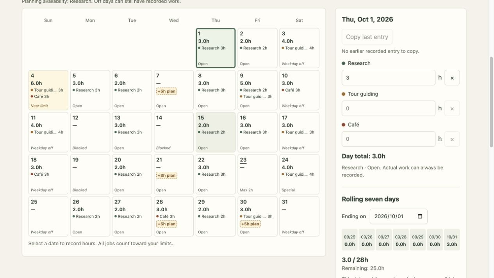

# Jikanri

**[Try Jikanri live](https://thikeyeman.github.io/Jikanri/)**

A browser-based work-hour tracker and scheduling planner.

## Why I built it

I built this to manage part-time working hours while studying in Japan. With multiple jobs, I needed to track individual limits and combined rolling seven-day totals. The time trackers I tried could record hours, but did not easily work out how much more I could schedule.

I started with a Python prototype, then a standalone browser application. Jikanri is a cleaner rebuild with a simpler interface and scheduling suggestions.

## What it does

- Records hours across multiple jobs, including archived jobs.
- Checks daily, weekly, monthly, and rolling seven-day limits.
- Suggests additional hours for one job, accounting for every job's records.
- Handles job availability, date exceptions, and monthly overrides.
- Saves locally, with undo/redo and JSON backup/restore.

Open `index.html` or visit the live site. **Try demo** loads fictional data without replacing your normal records; refreshing ends demo mode. Keep JSON backups because browser storage can be cleared. Use the hosted site for generating standalone HTML exports.

## How it works

[OPTIMIZER.md](OPTIMIZER.md) walks through the mathematics. [ARCHITECTURE.md](ARCHITECTURE.md) explains the code and trade-offs.

Built with HTML, CSS, vanilla JavaScript, localStorage, SVG, and the bundled **javascript-lp-solver 1.0.3**. The planner uses mathematical optimization, not AI, and is a personal planning aid rather than a legal compliance check.
